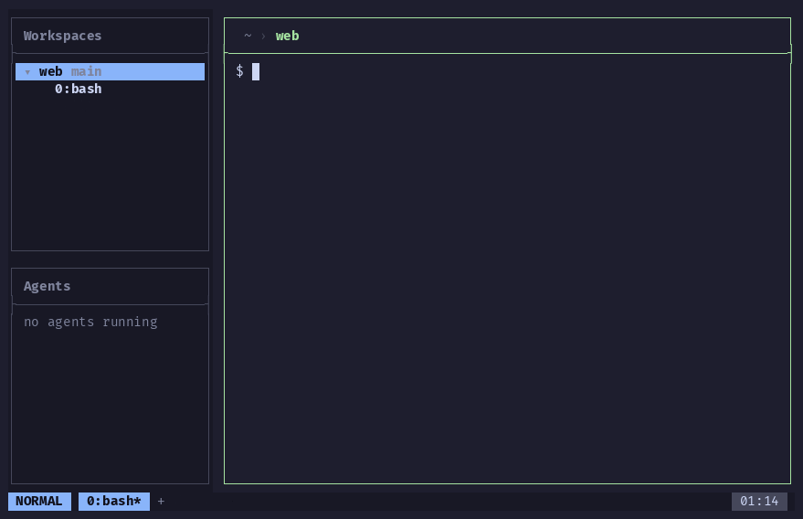
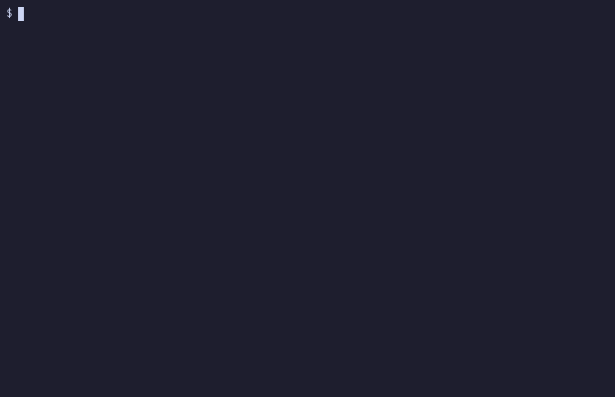
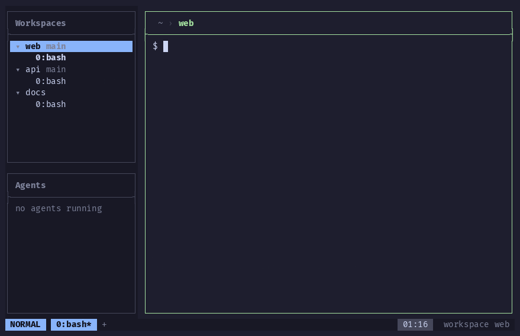

# corgi

A tmux-style terminal UI for [herdr-core](https://github.com/herdrdev/herdr-core) (`hc`).
Core keeps the terminals running; corgi arranges them into workspaces, windows and panes, with tmux keys,
a sidebar of workspaces and agents, and agent status that agents report themselves. Detach, close the
window or lose your ssh connection: the programs keep running in core, and the next `corgi` shows them again.

```
┌───────────────────────┐ ┌──────────────────────────────────┐┌────────────────────────────────┐
│ Workspaces            │ │ ~ › src › web                    ││ web › claude › Fixing a bug  ⠹ │
├───────────────────────┤ ├──────────────────────────────────┤├────────────────────────────────┤
│ ▾ ● web main          │ │ $ cargo test                     ││ > Reading src/main.rs          │
│     0:zsh             │ │    Compiling web v0.1.0          ││ > Editing src/parse.rs         │
│   ● 1:claude          │ │     Finished `test` profile      ││                                │
│ ▾ api feature/login   │ │      Running unittests           ││                                │
│     0:nvim            │ │ test result: ok. 42 passed       ││                                │
│                       │ │ $                                ││                                │
└───────────────────────┘ │                                  ││                                │
┌───────────────────────┐ │                                  ││                                │
│ Agents                │ │                                  ││                                │
├───────────────────────┤ │                                  ││                                │
│ ● claude web:1:claude │ │                                  ││                                │
│                       │ │                                  ││                                │
└───────────────────────┘ └──────────────────────────────────┘└────────────────────────────────┘
 NORMAL   0:zsh   1:claude* ●   +                             1 working   claude 62% left of 5h
```

The default look: the sidebar with the workspace tree and every agent, each pane in its own box with a
breadcrumbs row (the spinner says the agent is working), and the tab bar with the mode badge, the windows and
usage segments.

## See it

**Keys, splits and windows.** `C-b` shows every key you can press next; `%` and `"` split, `z` zooms,
`c` makes a window.


**Agents.** An agent says what it's doing (OSC 7501); corgi shows it in the pane's breadcrumbs, the sidebar
and the tab bar. When it needs you, a toast says so wherever you are, and `C-b a` takes you there.



**Detach and come back.** `C-b d` leaves; the programs keep running in core. Run `corgi` again and they're
where you left them.



**The chooser and copy mode.** `C-b w` lists every workspace, window and pane: type to filter, Enter to go.
`C-b [` is copy mode: search, select (here a block, with `C-v`), copy, and paste with `C-b ]`.



The demos are recorded from corgi itself (`just demos`), each on a scratch core and home folder.

## Install

On Apple Silicon macOS or Linux (x86_64, arm64), with Homebrew:

```sh
curl -fsSL https://releases.herdr.dev/core/install.sh | sh   # hc, if you don't have it (0.1.19 or newer)
brew install hong-yi/tap/corgi
corgi doctor                                                # checks that corgi reaches core
```

Or download a build from [the releases](https://github.com/hong-yi/corgi/releases), or build from source
(`./scripts/bootstrap.sh && cargo install --path crates/corgi --locked`). See [Install](docs/user/install.md) for
each, the requirements and updating. Windows isn't supported yet.

## Quick start

```sh
corgi
```

corgi connects to core (starting it if needed) and opens your shell in a workspace for the current folder.
Then:

```
C-b       show the keys you can press next (Esc cancels)
C-b c     new window
C-b %     split the pane right   (C-b " splits down)
C-b ←→    move between panes
C-b z     zoom the pane
C-b ?     every key, searchable
C-b d     detach: corgi exits, everything keeps running
```

Run `corgi` again to come back. [Your first session](docs/user/first-session.md) walks through it.

## Coming from tmux or herdr

- [Coming from tmux](docs/user/coming-from-tmux.md): the keys are tmux's where corgi has the command, and
  `C-b :` takes tmux-style commands (`split-window -h`, `select-layout tiled`, …).
- [Migrating from herdr](docs/user/migrating-from-herdr.md): `keys.preset = "herdr"` gives the old herdr TUI's
  keys, and `corgi migrate` turns your herdr config into a corgi one.

## Documentation

Getting started:

- [Install](docs/user/install.md)
- [Your first session](docs/user/first-session.md)

Concepts:

- [Concepts](docs/user/concepts.md): core and corgi, workspaces, addresses, where the layout lives
- [Agent status](docs/user/agent-status.md): OSC 7501, done vs seen, rollup

Using corgi:

- [Workspaces and windows](docs/user/workspaces-and-windows.md)
- [Panes and layouts](docs/user/panes-and-layouts.md)
- [Navigation](docs/user/navigation.md)
- [Copy mode](docs/user/copy-mode.md)
- [Mouse](docs/user/mouse.md)
- [Remote machines](docs/user/remote-machines.md)
- [Worktrees](docs/user/worktrees.md)
- [Notifications](docs/user/notifications.md)
- [Custom commands](docs/user/custom-commands.md)
- [Usage status](docs/user/usage-status.md)
- [Themes](docs/user/themes.md)

Reference:

- [Key bindings](docs/user/keybindings.md)
- [Commands](docs/user/commands.md)
- [Actions](docs/user/actions.md)
- [Configuration](docs/user/configuration.md)
- [Pane tabs](docs/user/pane-tabs.md)
- [Sidebar tokens](docs/user/sidebar-tokens.md)
- [Usage providers](docs/user/usage-providers.md)
- [Command line](docs/user/cli.md)
- [Files and paths](docs/user/files-and-paths.md)
- [Labels](docs/user/labels.md)

Help:

- [Troubleshooting](docs/user/troubleshooting.md)
- [FAQ](docs/user/faq.md)

For people working on corgi: [the plan](docs/PLAN.md), [the docs outline](docs/OUTLINE.md),
[the handoff notes](docs/dev/HANDOFF.md) and [the ADRs](docs/dev/adr/).

What changed: [the changelog](CHANGELOG.md). corgi is licensed under the [MIT License](LICENSE), except
`crates/corgi-vt/build.rs`, which is derived from herdr-core and stays under the
[Apache License 2.0](crates/corgi-vt/LICENSE-APACHE).

## Build

Needs Rust stable (1.88 or newer), libclang (Xcode / Command Line Tools on macOS, `libclang-dev` on Linux),
git, curl and python3.

```sh
./scripts/bootstrap.sh   # pinned Zig -> .tools/zig, Ghostty -> vendor/ghostty (or: just bootstrap)
cargo run                # corgi against your core; C-b shows keys, C-b d detaches
cargo run -- attach t3   # view one core terminal
cargo run -- doctor      # check the herdr-core connection
cargo test --workspace   # core and end-to-end tests need `hc` on PATH (skipped otherwise)
just check               # what CI runs: fmt check, clippy with warnings denied, tests
```

The bootstrap script touches nothing outside the repository. The pins are in `scripts/pins.env`.
`just run <args>` is `cargo run -p corgi-tui -- <args>`.

Tests never touch your own core: each one starts its own core session in a scratch folder under `target/tmp`.

## Repository layout

- `crates/hc-proto`: the herdr-core client protocol
- `crates/corgi-vt`: the pane terminal emulator, over libghostty-vt
- `crates/corgi`: the app
- `docs/user`: the user guide
- `docs/dev`: notes and decisions for people working on corgi
